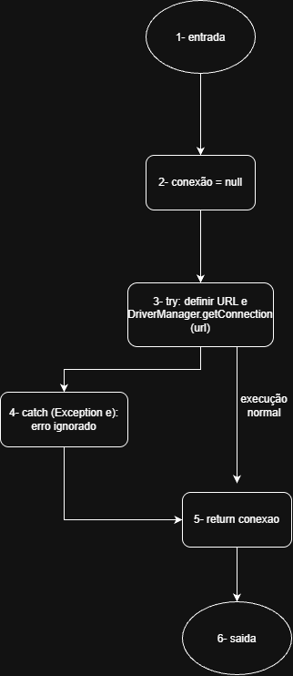
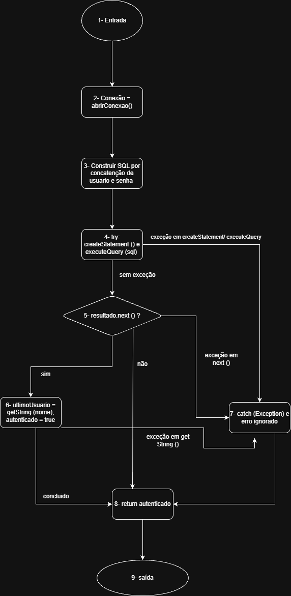

# Atividade de Caixa Branca – Autenticação com JDBC

**Aluno:** Francesco Giordano  
**RA:** 250941  
**Cenário:** 1 – Autenticação com JDBC

## 1. Objetivo

A atividade analisa um código Java que faz autenticação usando JDBC e MySQL. Primeiro foi observado o código original e seu fluxo de execução. Depois foi preparada uma versão revisada e uma sequência de testes para conferir os comportamentos principais.

A análise estrutural considera os métodos `abrirConexao()` e `autenticar()`. Os diagramas representam o código original, antes das correções.

## 2. Organização do projeto

```text
atividade-caixa-branca/
├── original/       # código recebido
├── revisado/       # versão com alterações
├── testes/         # testes automatizados
├── diagramas/      # grafos dos dois métodos
├── evidencias/     # saída da execução dos testes
├── PLANO_DE_TESTE.xlsx
└── README.md
```

## 3. Análise do código original

Na leitura do código, foram observados estes pontos:

| Local | Problema | Consequência possível |
|---|---|---|
| `abrirConexao()` | Credenciais do banco ficam escritas na URL. | Exposição de usuário e senha. |
| `autenticar()` | A consulta SQL é montada por concatenação. | Possibilidade de SQL Injection. |
| Blocos `catch` | As exceções são ignoradas. | Fica difícil identificar a causa de uma falha. |
| `abrirConexao()` / `autenticar()` | A conexão pode ser nula e depois utilizada. | Pode ocorrer `NullPointerException`. |
| `autenticar()` | Os recursos JDBC não são fechados explicitamente. | Recursos podem ficar ocupados. |
| `autenticar()` | O estado `autenticado` não é reiniciado no início. | Uma tentativa anterior pode influenciar a próxima. |
| `autenticar()` | Não há validação de usuário e senha vazios. | Entradas inválidas chegam à consulta. |

## 4. Grafos e complexidade ciclomática

Foi utilizada a fórmula **V(G) = E − N + 2P**, em que N é o número de nós, E é o número de arestas e P é a quantidade de componentes conectados. Para cada método, P = 1.

### 4.1 `abrirConexao()`

Diagrama: `diagramas/abrirConexao.png`.



- Nós (N): 6
- Arestas (E): 6
- Componentes (P): 1

**V(G) = 6 − 6 + 2(1) = 2**

Caminhos básicos considerados:

1. Entrada → inicialização da conexão → tentativa de conexão concluída → retorno da conexão → saída.
2. Entrada → inicialização da conexão → exceção capturada → retorno da conexão → saída.

### 4.2 `autenticar()`

Diagrama: `diagramas/autenticar.png`.



- Nós (N): 9
- Arestas (E): 12
- Componentes (P): 1

**V(G) = 12 − 9 + 2(1) = 5**

Caminhos básicos considerados:

1. A consulta retorna sem encontrar usuário.
2. A consulta encontra usuário e atualiza o nome e o estado de autenticação.
3. Ocorre exceção durante a criação do `Statement` ou execução da consulta.
4. Ocorre exceção durante `resultado.next()`.
5. Ocorre exceção durante a leitura do nome com `getString()`.

Os caminhos acima são os caminhos independentes considerados para a análise estrutural. A existência de um caminho no grafo não significa, por si só, que ele tenha sido reproduzido em um teste.

## 5. Alterações na versão revisada

A versão revisada está em `revisado/AutenticacaoRevisada.java`. As principais mudanças foram:

- uso de `PreparedStatement` com parâmetros no lugar da concatenação de strings;
- leitura das credenciais de conexão por variáveis de ambiente (`DB_URL`, `DB_USER` e `DB_PASSWORD`);
- fechamento automático dos recursos com `try-with-resources`;
- reinicialização do estado de autenticação a cada tentativa;
- validação de entradas nulas ou vazias;
- propagação de `SQLException`, em vez de ignorar o erro;
- possibilidade de fornecer um provedor de conexão, facilitando os testes sem banco externo.

A implementação é didática. Em um sistema real, as senhas dos usuários não devem ser comparadas em texto puro: deve ser utilizado armazenamento com hash de senha apropriado. A tabela e a consulta também precisam ser adaptadas ao mecanismo real de armazenamento de senhas.

## 6. Plano e execução dos testes

Os casos estão descritos na planilha `PLANO_DE_TESTE.xlsx` e implementados em `testes/TesteAutenticacao.java`. Foram utilizados objetos simulados para as interfaces JDBC; portanto, esta execução não comprova a integração com um servidor MySQL real.

| ID | Cenário | Resultado esperado |
|---|---|---|
| CT01 | Login válido | Retorna `true` e atualiza o nome. |
| CT02 | Usuário não encontrado | Retorna `false`. |
| CT03 | Usuário vazio | Retorna `false` sem abrir conexão. |
| CT04 | Falha ao obter conexão | Propaga `SQLException`. |
| CT05 | Tentativa válida seguida de inválida | A segunda tentativa não mantém o estado anterior. |
| CT06 | Falha durante a consulta | Propaga `SQLException`. |

### Como executar

Com JDK instalado, na pasta principal do projeto, execute:

```bash
mkdir -p classes
javac -d classes revisado/AutenticacaoRevisada.java testes/TesteAutenticacao.java
java -cp classes TesteAutenticacao
```

No Windows PowerShell, se `mkdir -p` não funcionar, crie a pasta `classes` pelo Explorador de Arquivos e execute apenas os comandos `javac` e `java`.

A saída registrada em `evidencias/resultado-testes.txt` corresponde à execução realizada durante a preparação deste pacote: **6 testes passaram e 0 falharam**. Para reproduzir, execute os comandos acima no seu computador.

## 7. Limitações

- Os testes utilizam simulações das interfaces JDBC.
- Não foi realizada conexão com um servidor MySQL real nesta execução.
- A configuração do driver JDBC e do banco real fica para uma etapa de integração.
- A análise dos caminhos excepcionais segue a representação adotada no diagrama da atividade.

## 8. Conclusão

A análise mostrou que o código original tinha problemas relacionados à segurança da consulta, ao tratamento de erros e ao gerenciamento dos recursos JDBC. A versão revisada aplica parâmetros na consulta, fecha os recursos automaticamente e deixa as falhas visíveis para quem chama o método. Os testes simulados verificaram os comportamentos principais previstos para essa versão.

## 9. Referências

- Oracle. *JDBC Basics*. https://docs.oracle.com/javase/tutorial/jdbc/
- Oracle. *Java Documentation*. https://docs.oracle.com/en/java/javase/
- OWASP. *SQL Injection Prevention Cheat Sheet*. https://cheatsheetseries.owasp.org/cheatsheets/SQL_Injection_Prevention_Cheat_Sheet.html
